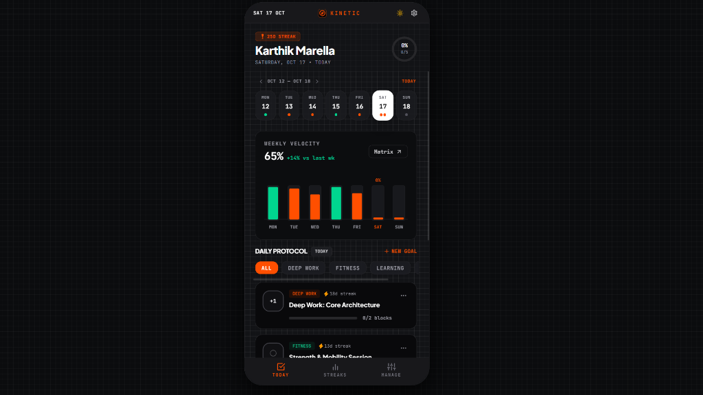
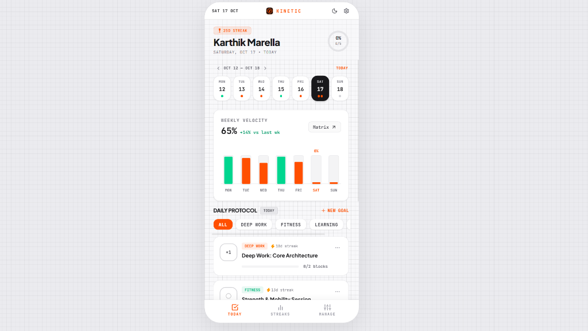
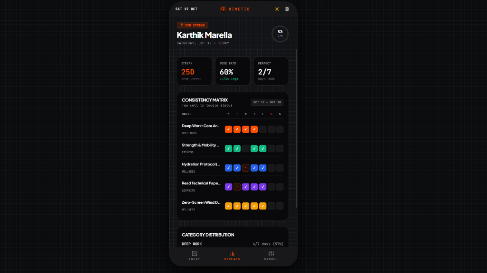
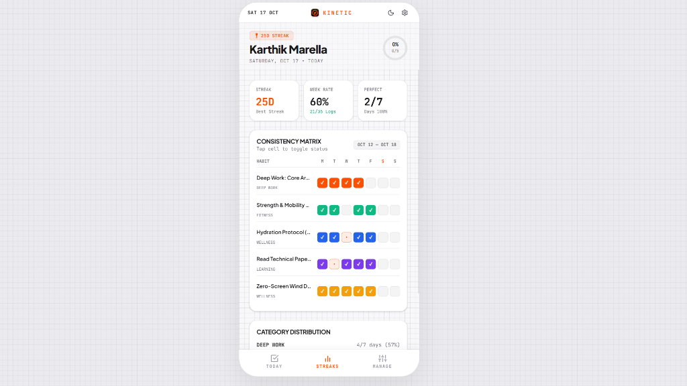

# KINETIC – Habit Tracker ⚡

  

  <strong>High-performance habit tracking with engineering telemetry, weekly velocity analytics, and consistency matrices.</strong>

  
  
  
  
  
  

---

## Overview

**KINETIC** is a precision-engineered habit tracking Progressive Web App (PWA) designed for high performers who want to turn daily routines into measurable momentum. Inspired by Swiss industrial design and telemetry dashboards, KINETIC elevates habit tracking from a mundane checklist into an actionable performance cockpit.

- **Real-Time Daily Protocol:** Check off multi-step habits, track completion percentages, and build unbreakable streaks.
- **Weekly Velocity Engine:** Gain immediate visibility into your 7-day performance with automated momentum trends.
- **Consistency Matrix:** Review every habit across Mon–Sun with tap-to-toggle cell editing and category distributions.
- **Dual Visual Architecture:** Switch seamlessly between high-contrast Light Mode and sleek Dark Mode with an authentic 12px precision blueprint grid canvas.

---

## Visual Showcase

### 1. Main Protocol Dashboard (Today View)
*Track daily routines, visualize dynamic completion rings, and monitor weekly velocity.*

| Dark Mode | Light Mode |
| :---: | :---: |
|  |  |

---

### 2. Consistency Matrix & Streaks Analytics
*Mon–Sun habit performance matrix, streak records, and category distribution metrics.*

| Dark Mode Matrix | Light Mode Matrix |
| :---: | :---: |
|  |  |

---

## Key Features

### ⚡ Daily Protocol & Streak Tracking
- **Multi-Step Targets:** Configure habits with discrete targets (e.g., 2 blocks of Deep Work, 6 glasses of hydration, 20 pages of reading) with incremental `+1` / `-1` logging.
- **Dynamic Completion Ring:** SVG radial gauge that animates your daily completion percentage in real time.
- **Streak Protection:** Automated streak engine that tracks consecutive days completed and protects historical milestones.
- **Category Segmentation:** Instant filtering across `DEEP WORK`, `FITNESS`, `LEARNING`, and `WELLNESS`.

### 📊 Weekly Velocity Analytics
- **7-Day Consistency Percentage:** Automatically calculates your aggregate weekly execution rate.
- **Color-Coded Status Bars:**
  - 🟢 **Emerald Green (`#00D68F`):** 100% Perfect execution days.
  - 🟠 **Swiss Orange (`#FF4F00`):** In-progress or partial completion.
- **Interactive Day Navigation:** Click any day bar to instantly jump your protocol view to that date.
- **Momentum Comparison:** Real-time indicator displaying week-over-week performance changes.

### 🗓️ Multi-Week & Month Time Travel
- **Pagination Arrows (`‹` and `›`):** Step backward to inspect previous weeks and months or step forward to plan ahead.
- **`JUMP TO TODAY` Button:** One-touch return that instantly snaps the view back to the current day.
- **Date-Range Dynamic Queries:** Automatically queries historical logs from the local database for any chosen week.

### 🔲 Consistency Matrix
- **Heatmap Grid:** Full 7-day matrix tracking all habits side by side.
- **Direct Cell Toggling:** Tap any matrix cell directly to toggle or log habit status without leaving the view.
- **Category Distribution:** Visual progress bars displaying consistency percentages across routine categories.

### ⚙️ Customizable Settings & Privacy
- **Personalized Profile Name:** Edit and persist your display name (defaults to *Karthik Marella*).
- **Clean Slate / Wipe All:** Reset all data with a safety confirmation (`"Tap to Confirm"`) to start streaks 100% fresh from Day 1.
- **Restore Sample Habits:** Re-seed standard demo routines with one click.
- **Local Engine Privacy:** All habits and logs are stored privately in your local database with zero external tracking.

---

## Tech Stack & Architecture

| Layer | Technology | Details |
| :--- | :--- | :--- |
| **Framework** | Next.js 16 (App Router + Turbopack) | Fast Server Components, Route Handlers, and instant client hydration. |
| **Language** | TypeScript 5 | Strict typing across all components, models, and date helpers. |
| **Styling** | Tailwind CSS v4 + Vanilla CSS | Precision tokens, 12px blueprint grid pattern, custom animations. |
| **Database** | SQLite 3 | Embedded zero-latency relational database. |
| **ORM** | Prisma 6 | Type-safe schema models and relational log querying. |
| **Icons** | Lucide React | Modern geometric iconography. |
| **Typography** | Google Fonts | *Plus Jakarta Sans* (geometric sans) & *JetBrains Mono* (telemetry mono). |
| **Deployment** | Netlify | Serverless deployment configured via `netlify.toml`. |

---

## Why KINETIC?

Most habit trackers feel like passive checklists. **KINETIC** treats habit formation as an engineering feedback loop:
- You see your **velocity** in real numbers, not vague emojis.
- You can step through **previous weeks** to diagnose where habits slipped.
- You have an authentic **Consistency Matrix** to inspect your rhythm across all categories.
- Built as an installable **PWA** with native mobile touch interactions and a docked bottom stage.

---

  Built with precision by <strong>Karthik Marella</strong> ⚡

